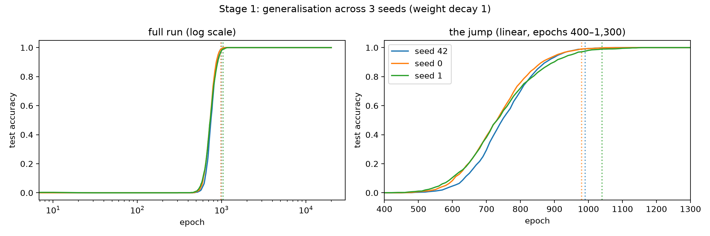

# <!-- TODO (Edward): project title --> grokking-modular-addition

<!-- TODO (Edward): one-line summary that also says what grokking is (fold your "What is grokking?" sentences in here). -->

<!--
Suggested one-liners:
1. Reproducing grokking (a network suddenly generalising long after it has memorised its training data) on modular addition: first with an MLP, then with the one-layer transformer of Nanda et al. (2023).
2. Grokking from scratch: a small MLP memorises (a + b) mod 53 by epoch ~180, then suddenly generalises around epoch ~1,000, but only with weight decay.
-->

## Stage 1 result: an MLP groks modular addition


<!-- TODO (Edward): your claim and its caveats. -->

<!--
Raw material: p = 53, 50% train, embed 128, hidden 256, batch 64, AdamW lr 3e-4,
weight decay 1, 20k epochs. Memorised (train acc ≥ 99%) at epochs 180 / 180 / 190,
generalised (test acc ≥ 99%) at 990 / 980 / 1,040 for seeds 42 / 0 / 1.
Weight decay 0 never generalised in 20k epochs.
Caveats: ±10 epochs (logging interval); 99% threshold; only 3 seeds;
the seed sets both the initialisation and the train/test split.
-->

<details><summary>More figures</summary>




</details>

## How to run

```bash
python3 -m venv .venv && source .venv/bin/activate && pip install -r requirements.txt
python train.py                                            # main run: weight decay 1, seed 42
python train.py --weight_decay 0 --run_name mlp_wd0        # control: no weight decay
for seed in 42 0 1; do python train.py --seed $seed; done  # seed sweep
python train.py --preset mlp --lr 1e-3 --batch_size none   # --preset <name>, then --key value overrides
```

**Status:** Stage 0 skeleton ✅ · 1 MLP grokking ✅ · 2 transformer reproduction of Nanda et al. 2023 (in progress) · 3 controls and sweeps · 4 mechanistic analysis · 5 progress measures

## Repo layout

```
config.py                # all settings, as presets (--preset mlp | transformer)
train.py, data.py, model.py, transformer.py, utils.py
analysis/                # notebooks and figures/
runs/                    # created by train.py; git-ignored
```
<!-- TODO (Edward): one-line description of analysis/plot_curves.ipynb (or delete this TODO if the layout doesn't list notebooks). -->

## How this was built

<!-- TODO (Edward): your note on how you used AI in this project. -->

<!--
Prompts: What did I write myself? What did AI write (which files, which tool)?
How did I check it (reading every line, epoch-0 loss ≈ ln 53, comparing with the reference notebook, re-running)?
-->

## References

- Power et al. (2022). *Grokking: Generalization Beyond Overfitting on Small Algorithmic Datasets.* [arXiv:2201.02177](https://arxiv.org/abs/2201.02177)
- Nanda et al. (2023). *Progress measures for grokking via mechanistic interpretability.* [arXiv:2301.05217](https://arxiv.org/abs/2301.05217)
- grokking-main reference notebook (source of the Stage 1 MLP settings). <!-- TODO (Edward): add its URL. -->
