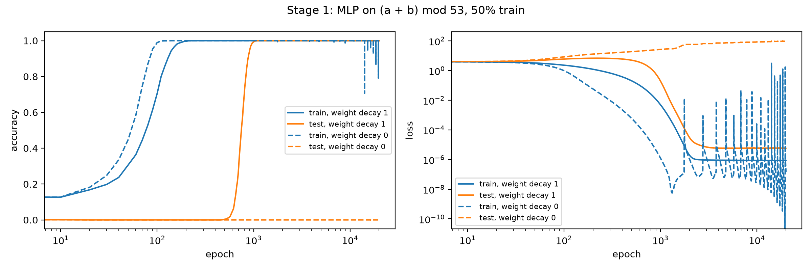
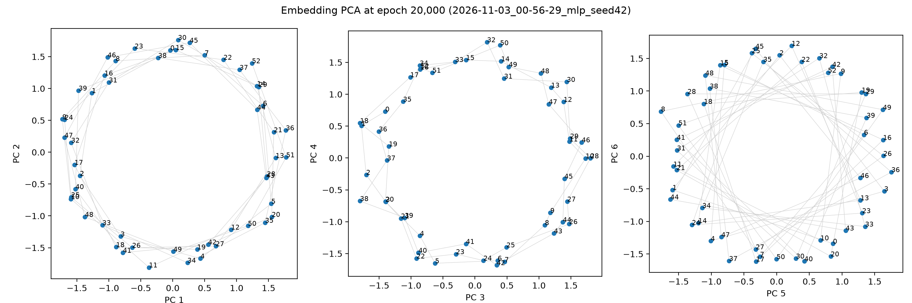

# Grokking modular addition: MLP and Transformer Reproductions

Reproduction of the 'grokking' phenomenon from Power et al 2022 — followed by analysis using techniques in mechanistic interpretablity following Nanda et al 2023 

'grokking': models abruptly transition to a generalizing solution after a large number of training steps, despite initially overfitting (Power et al 2022)

Please Note: This repo is still a work in progress — the transformer model is now written but train.py needs updating before the mechanistic interpretablity steps begin.

**Status:** Grokking MLP — complete. One-layer transformer reproduction of Nanda et al. — in progress.

## MLP grokking on modular addition task:



A one-hidden-layer MLP (128-d embedding → 256 ReLU → 53 logits), trained on (a + b) mod 53
with half of all pairs, memorises the training set by epoch ~185 but only generalises
(test accuracy ≥ 99%) at epochs 980–1,040, about five times later, across three seeds.
With weight decay 0 it never generalises in 20,000 epochs.

| Seed | Memorised (train ≥ 99%) | Generalised (test ≥ 99%) |
|---|---|---|
| 42 / 0 / 1 | 180 / 180 / 190 | 990 / 980 / 1,040 |
| 42, weight decay 0 | — | never |


<details><summary>More figures</summary>




</details>

## How to run

```bash
python3 -m venv .venv && source .venv/bin/activate && pip install -r requirements.txt
python train.py                                            # main run: weight decay 1, seed 42
python train.py --weight_decay 0 --run_name mlp_wd0        # control: no weight decay
for seed in 42 0 1; do python train.py --seed $seed --run_name mlp_s$seed; done  # seed sweep
python train.py --help                                     # list every setting you can override
```

## How this was built

I come from scientific computing (single-script projects), and used this project to learn
software-engineering practice. I used Claude as a tutor and code reviewer: it assessed an earlier
project of mine, suggested the repo structure, explained concepts, reviewed my code, and wrote
boilerplate (command-line options, config presets, plotting helpers) and parts of the tests.
The core ML code (data.py, model.py, train.py, transformer.py) is my own, written with the
reference implementations below to check against. Results were verified with sanity checks
(initial loss ≈ ln p, disjoint train/test splits, parameter counts, a deterministic rerun).

## References

- Power et al. (2022). *Grokking: Generalization Beyond Overfitting on Small Algorithmic Datasets.* [arXiv:2201.02177](https://arxiv.org/abs/2201.02177)
- Nanda et al. (2023). *Progress measures for grokking via mechanistic interpretability.* [arXiv:2301.05217](https://arxiv.org/abs/2301.05217)
- scienceetonnante, *grokking*: MLP reproduction of grokking on modular addition
  (reference for Stage 1): https://github.com/scienceetonnante/grokking
